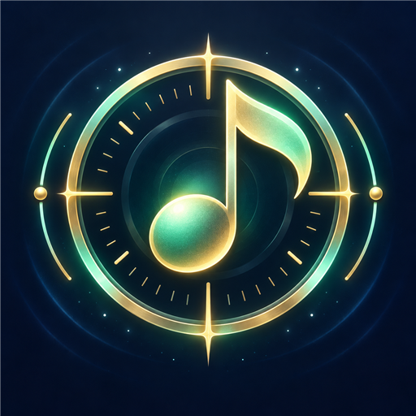
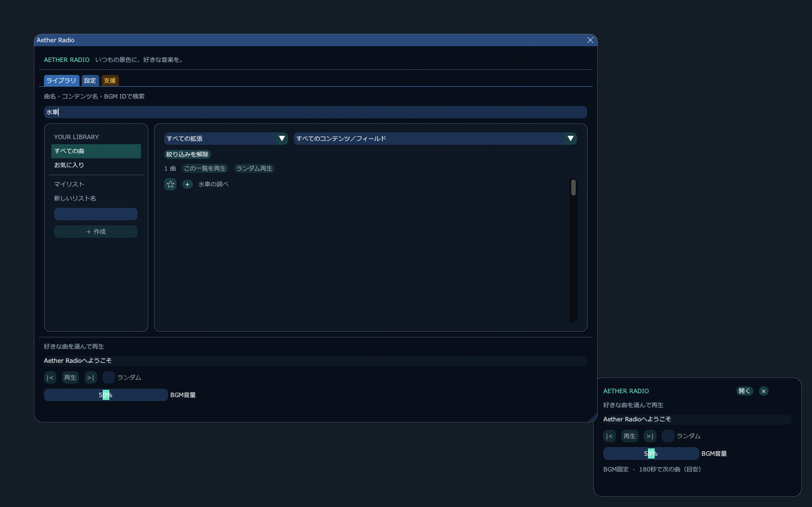

# BGMPlayer

FFXIVのBGMを選んで再生するDalamudプラグインです。作者: **Roxyz0501**。





上の画像は実装したUIの単体描画プレビューです。ゲーム内のスクリーンショットではありません。

## 機能

- 上部の拡張タブ → 討滅・ノーマルレイド（零式含む）・アライアンス・特殊コンテンツ・ダンジョン・フィールドなどのタブ → コンテンツ名のプルダウンで絞り込み。
- 過去の曲を新しい拡張にも表示するか、設定で切り替え。
- 最近再生した30曲の一覧。ログアウトするとクリアします。
- ミニプレイヤーからゲームBGMへ復帰、再生中の曲をお気に入りへ登録。
- 曲一覧はページ送りなしのスクロール表示。画面内の行だけを描画します。
- BGM表とオーケストリオンのファイル表から、インストール済みの曲を収集。コンテンツとの対応がない曲は「その他」に表示。曲名未登録のファイルも対象です。
- 「闘う者達」「更に闘う者達」など、通常BGM表にないオーケストリオン曲にも対応。「闘う者たち」でも検索できます。
- 日本語曲名・BGM ID・場所・メタデータによる検索。
- お気に入り、複数マイリスト、名前変更、曲の追加／削除／並べ替え。
- 重複しないシャッフル、前／次、リストリピート、1曲の継続再生。
- メイン・ミニ両方のシークバーで、対応曲の再生位置を変更できます。
- 対応曲の実際の長さによる自動曲送り。従来方式の曲には目安の時間を使用。
- 四隅への配置、自由移動、位置固定、背景の不透明度、BGM音量。
- 再生中のBGM固定、停止時のゲームBGM復帰。設定・リストはDalamudに保存。
- 任意の「支援」タブ。支援による機能制限はありません。

旧称はAether Radioです。既存のインストールを更新するとBGMPlayerになり、マイリストや設定は引き継がれます。
旧コマンド `/aetherradio` も互換用に使用できます。

## インストール

1. `/xlsettings` の「試験的機能」からカスタムプラグインリポジトリを追加します。
2. 次のURLを登録して設定を保存します。

   `https://raw.githubusercontent.com/Roxyz0501/DalamudPluginRepo/main/repo.json`

3. `/xlplugins` で **BGMPlayer** を検索してインストールします。
4. `/bgmplayer` で曲を選びます。`/bgmplayer stop` は固定を解除します。

現在の公開版はプレビューです。ゲーム内の音声再生・固定・復帰の実機確認は未完了です。

### 開発用DLLを直接読み込む場合

1. Release ZIPを任意の専用フォルダーに展開します。
2. Dalamudの開発プラグイン設定に、展開した `AetherRadio.dll` のパスを追加します。
3. 開発プラグイン一覧からBGMPlayerを読み込みます。
4. `/bgmplayer` で曲を選びます。`/bgmplayer stop` は固定を解除します。

ミニプレイヤー上部の「BGMPlayer」をドラッグして移動できます。
「固定」で位置を固定し、「解除」で再び移動できます。位置は次回も保持します。

曲の「＋」でマイリストへ追加できます。再生ボタンは選択した一覧を再生キューとして
取り込みます。再生後のリスト編集は、次にその一覧を再生するときに反映されます。
停止はゲームBGMに戻す操作です。再生し直すと曲の先頭から始まります。
メイン・ミニプレイヤーのループボタンは「リスト全体 → 1曲 → オフ」の順で切り替わります。
「1」が付いたアイコンが1曲ループです。この間は自動で次の曲へ進みません。
初期設定は1曲ループです。旧版からの更新時も一度だけ1曲ループへ切り替わります。
その後に選んだモードは、次回以降も保持します。
シークバーをクリック、またはドラッグして離すと、その位置から再生します。
時刻は現在位置／曲の長さです。対応するOgg Vorbis形式の曲をメモリ内で読み込み、
Windowsの既定の出力先から再生します。読み込み中や非対応形式ではバーが無効になります。
非対応形式は従来のゲーム音声で再生します。音声ファイルの保存・外部送信は行いません。

シーク対応曲の音量は、このプレイヤーの0〜200%で調整します。100%は音源の元の音量です。
ゲームのBGM音量・マスター音量・ミュート・非アクティブ時の消音設定は適用されません。
Windowsの音量ミキサーは有効です。再生先を変更した場合は一度停止して再生し直してください。
SE・ボイス・環境音とゲームの保存設定は変更しません。停止・ログアウト・終了時にはゲームBGMに戻します。
非対応形式では従来どおりゲーム側のBGM音量を基準に調整します。

オーケストリオンが流れている場所では、BGMPlayerの再生中だけ自分に聞こえる
オーケストリオン音を抑えます。停止すると、その時点の曲が再び聞こえます。
家具側の曲・プレイリストや、他のプレイヤーに聞こえる音は変更しません。

ログアウトすると再生・BGM固定を解除し、選択中の曲・再生キュー・経過時間をリセットします。
マイリスト・お気に入り・音量・ウィンドウ位置は保持します。
次のログインでは停止状態から、曲を選んで再生できます。

## 設定の保存と復元

設定は操作直後に反映し、ファイルへの書き込みは60秒ごとに変更がある場合だけ行います。
ログアウト・ゲームの正常終了・プラグイン無効化時には未保存の変更を保存します。
値を元に戻した場合は保存しません。強制終了やクラッシュでは、未保存の最大約60秒分が失われる場合があります。

設定本体は従来の `AetherRadio.json` です。同じディレクトリに直前の正常設定を最大3世代保持します。
起動時に本体が壊れていれば、新しい正常バックアップから設定を読み込み、次の保存時に本体を復元します。
破損した本体は `.corrupt-...json` として残します。正常な本体がある場合はそちらを優先します。
正常な復元候補がない場合や、より新しい版の設定の場合は、元データを上書きせず読み込みを中止します。
1ファイルの読み込み上限は16 MiBです。

保存失敗時は未保存内容をメモリに保持し、60秒間隔で再試行します。連続3回失敗すると自動保存を止めます。
設定画面に状態を表示するので、空き容量やアクセス権などの原因を解消して「保存を再試行」を押してください。
保存できないまま終了した場合、未保存の変更は残せません。
バックアップ整理だけが失敗した場合は設定の保存成功とは分けて表示し、余分な世代を一時的に保持します。

再生履歴はログイン中の30曲をメモリに保持するだけで、履歴ファイルは作りません。

## 分類と重複表示

「ノーマルレイド」には零式も含みます。「アライアンス」は通常のアライアンスレイド、
「特殊コンテンツ」は絶・滅、エウレカ、セイブ・ザ・クイーン、クレセントアイル、特殊ダンジョン探索などです。
ディープダンジョンは独立したジャンルに残しています。

設定の「新しい拡張にも過去の曲を表示する」は初期状態でオンです。
オフにすると、同じ音源パスの曲は関連先が確認できる最も古い拡張にだけ表示します。
これは拡張タブごとの表示設定で、正確な初出パッチを判定するものではありません。
音源が異なるアレンジ版は残します。「すべて」の拡張、お気に入り、マイリスト、最近の再生は対象外です。
分類の関連データがない曲は引き続き「その他」から選べます。

「最近の再生」は、このログイン中に再生に成功した最新30曲です。同じ曲は先頭へ移動します。
履歴はファイルに保存せず、ログアウト・プラグイン終了で消去します。
ミニプレイヤーの「ゲームBGMへ戻す」は再生を停止してゲーム側のBGMへ戻します。
その右の星ボタンで選択曲をお気に入りに追加・解除できます。

## 言語 / Language

`/bgmplayer` を開き、独立した **言語設定 / Language settings** タブの「表示言語」から変更できます。
日本語・English・Deutsch・Français・한국어・简体中文・繁體中文に対応しています。
変更はすぐに反映され、設定は変更がある場合だけ60秒ごとに保存します。マイリスト名、検索文字、再生設定は保持します。

言語が未設定の場合だけ、ゲームクライアント → Dalamud UI → Englishの順で初期値を決めます。
保存済みの選択は次回起動・ログアウト・キャラクター切替でも維持し、Autoは表示・保存しません。
このSDKには利用できる公開ランチャー言語連携がないため、別途ランチャーの設定ファイルは読みません。

曲名・コンテンツ名・拡張名はUI言語とは独立したゲームデータです。
一致する音源パスに正式なオーケストリオン曲名があればゲーム側の言語を使い、
それ以外は同梱の日本語曲名データを使用します。音源パスが異なるオーケストリオン版から
曲名を推測して対応付けることはしません。韓国語・中国語などの未提供のゲーム名は翻訳で作りません。
ジャンル、曲名未登録の表示、エラー、コマンドヘルプ、支援タブは選択したUI言語になります。

文字表示にはDalamudの管理フォントとWindowsの言語フォントを使用します。フォントは配布ZIPに同梱しません。
不足する文字がある場合は言語設定タブに案内を表示します。Windowsの追加言語フォントを確認してください。

Open the separate **Language settings** tab and choose **Display language** to change the UI instantly. Supported languages are Japanese, English,
German, French, Korean, Simplified Chinese and Traditional Chinese. The first launch uses the game language,
then the public Dalamud UI language, then English. Your saved choice is never replaced by later detection.
Official game names keep the game-data language; supplementary song titles can remain Japanese.

言語設定と支援タブはRoxyz0501の共通実装 `AetherRadio/CommonUi/StandardPluginTabs.cs` を使用しています。
BGMPlayerのプレイヤー部分は従来の外観を維持しています。
メインタブは「ライブラリ → 設定 → 言語設定 → 支援」の順です。

## 収録範囲・検証状況

対象はインストール済みゲームの `BGM`・`OrchestrionPath` 表にある、実在する音源です。
外部MP3、音声台詞の再生は対象外です。
コンテンツ内のすべての曲に分類用の関連データがあるわけではありません。
関連を取得できない曲は削除せず「その他」に表示します。
曲名・メタデータに明記された場所からの補助分類は、曲のツールチップで区別します。
曲名が不明な曲は「曲名未登録」と表示し、場所が分かる場合は場所名を添えます。
曲の識別番号も表示します。内部ファイル名はツールチップで確認できます。

Releaseビルドと実ゲームデータのオフライン照合、再生キューの自動テストを実施します。
ゲーム内でのネイティブ音声再生・全コンテンツでの固定・描画の実機確認は別途必要です。
確認結果は `VALIDATION.md`、公開状態は `PUBLICATION_STATE.md` に記録します。

シーク対応曲は実際の音声出力終了で自動曲送りを行います。設定秒数で早めに送ることもできます。
非対応曲の曲送りにはメタデータによる目安を使用します。シーク対応曲の1曲ループは
取得できたサンプル位置のループ区間を使い、区間がなければ曲全体を繰り返します。

## ローカル再生の設計

FFXIVClientStructsの `BGMSystem.SetBGM` / `ResetBGM` を介し、最優先のローカル
BGMシーンを使用します。再生中に同シーンへ来たゲーム側の要求は記録し、
固定解除時に最新の要求を戻します。他のBGMシーンは通常どおり更新されます。
パケット生成・送信、ネットワークフック、ゲームイベント送信、チャット送信は実装しません。
音源をサーバーや他プレイヤーへ送る機能はありません。
ログイン時の自動再生は行わず、ユーザーが曲を選んだときだけ開始します。

## ビルド

.NET SDK 10、Dalamud API 15の開発ライブラリが必要です。

```powershell
./tools/Build-Release.ps1 -DalamudLibPath 'D:/path/to/Dalamud/dev/'
dotnet run --project Tests -c Release -p:DalamudLibPath='D:/path/to/Dalamud/dev/'
```

実ゲームのカタログ検証には、テストコマンド末尾に `-- 'D:/path/to/game/sqpack'` を追加します。
配布ZIPは `artifacts/AetherRadio-1.0.0.1.zip` に生成されます。7言語のリソースはDLLへ埋め込まれます。

UIの単体検証には次のコマンドを使用できます。WindowsのMeiryo、Segoe UI、Malgun Gothic、
Microsoft YaHei、Microsoft JhengHeiを使用し、出力画像は指定ディレクトリに保存します。

```powershell
dotnet run --project Tests.Ui -c Release -p:DalamudLibPath='D:/path/to/Dalamud/dev/' -- 'D:/path/to/game/sqpack' 'work/ui-localization'
```

## 配布

専用ソース・Issue・Releaseリポジトリ: https://github.com/Roxyz0501/AetherRadio

配布には既存の共有Dalamudリポジトリを使用します。
https://raw.githubusercontent.com/Roxyz0501/DalamudPluginRepo/main/repo.json

`release/repository-entry.template.json` は共有インデックス用メタデータのテンプレートです。
独立したカスタムリポジトリではありません。各バージョンの公開時にアイコンURL・
ソースURL・Release ZIPを検証します。

## 出典とライセンス

曲名・検索用補足情報・推定時間は、Meli / perchbirdと貢献者による
[OrchestrionPlugin](https://github.com/perchbirdd/OrchestrionPlugin) のMITデータを使用しています。
BGMシーン優先度の理解にも同プロジェクトの実装を参照しました。
独立して作成したUI・カタログ・再生制御と、これらの第三者データは区別しています。
詳細は [THIRD_PARTY_NOTICES.md](THIRD_PARTY_NOTICES.md) と `licenses/` を参照してください。

本プロジェクトのコードはMITライセンスです。
任意の開発支援: [Roxyz0501 / Ko-fi](https://ko-fi.com/roxyz0501)

The main transport row includes a mini-player toggle next to Repeat. Blue means the mini-player is visible; its tooltip follows the selected UI language.

### Supplementary local tracks (1.1.2.0)

The catalogue also reads OrchestrionPath, even when its title or content association is absent. Only installed music files referenced by BGM or OrchestrionPath are included; unknown files outside those tables are not discovered by scanning hashed archives. No audio files are exported or distributed.

Supplementary songs retain stable plugin-only playlist IDs. Playback substitutes their installed path in the local SoundManager.PlayBGMSound call for an existing BGM scene carrier; synthetic IDs are never sent to SetBGM. This uses the game's BGM playback lifetime and music-only volume control. OrchestrionManager.PlayTrack/PlaySample and server-bound functions are not used. The new path playback needs live-game audio acceptance, including transitions, looping, volume and stop/logout restoration.

Version 1.1.3 excludes silent and login-screen carrier files and currently active/fading scene IDs. If a supplementary selection does not reach the local audio loader within eight seconds, playback stops with an error; this check does not certify audible output.

### Audio playback dependencies

Seekable playback uses [NAudio](https://github.com/naudio/NAudio) 2.2.1 (Mark Heath)
and [NVorbis](https://github.com/NVorbis/NVorbis) 0.10.5 (Andrew Ward), both MIT.
They decode the selected installed SCD in memory and output through the Windows
default device. No game audio files are included. See THIRD_PARTY_NOTICES.md.
